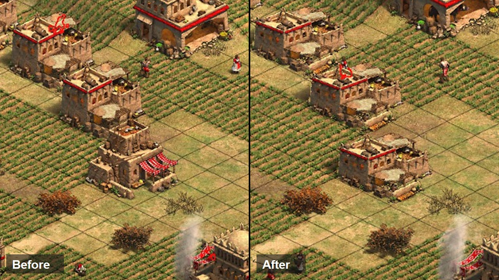

# AoE2 Mods

Age of Empires II: Definitive Edition mods by **hiiwave**.

## [Low-Profile Houses](mods/low-profile-houses/)

Shorter houses reveal more of nearby units, terrain and wall gaps while retaining the game's architectural character.
The current **0.6x Beta** uses a **120 px upper bound**. Graphics only: ground footprints, collision and gameplay data remain unchanged.

*Real in-game comparison around 25 minutes: original houses on the left, 0.6x Beta on the right.*

[Details, screenshots and technical documentation](mods/low-profile-houses/).
