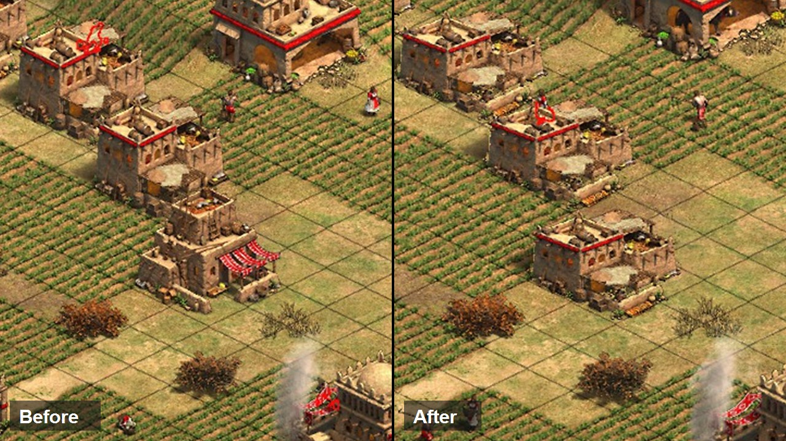
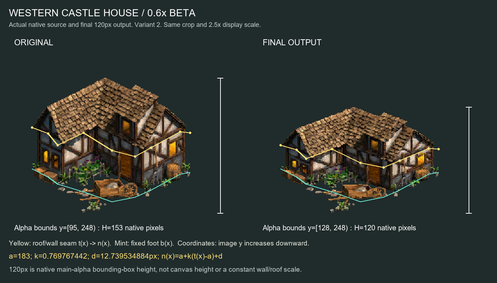

# Low-Profile Houses - 0.6x (Beta)

Author: **hiiwave**.

## A clearer view, without flat foundations

Tall houses can hide units, terrain and small gaps in a wall. Low-Profile Houses lowers their silhouette while keeping recognizable architecture. This is a visual trade-off: clearer bases and consistent house shapes, rather than maximum original variety.



*Around 25 minutes of gameplay. Left: original graphics. Right: 0.6x Beta. The comparison illustrates reduced obstruction, not changed collision or a newly passable route.*

## Current standard

Current version: **`2611.1-beta.5`** (CalVer). **0.6x names the height treatment, not a version number.**

- **120 px upper bound**, measured in the native standing-house main image. Houses at or below the target are not enlarged.
- One selected variant per architecture and age, repeated across the normal variation slots for a consistent look.
- **0.6x is an approximate above-ground height description**, not a universal 0.6 multiplier on image coordinates or an exact recovered 3D measurement.
- Graphics only. Ground footprints, collision and gameplay data remain unchanged. Visual selection and ground collision are separate systems.

## Install

[Open the published mod on Age of Empires](https://www.ageofempires.com/mods/details/583664).

## Method at a glance

### Join a roof to a fixed ground line



**Original variant 2 → actual encoded 120 px output**, shown at the same scale. Yellow: roof/wall seam. Mint: fixed foot line. These are image-space control polylines, not a reconstructed 3D mesh.

For source coordinates $(x,y)$ with $y$ increasing downward, let $t(x)$ be the roof/wall seam and $b(x)$ the foot line. Let $a$ be the vertical anchor, $k$ the roof’s vertical scale, and $d$ its downward shift in pixels. The transformed seam and wall scale are

```math
n(x)=a+k\bigl(t(x)-a\bigr)+d,
\qquad
\lambda(x)=\frac{b(x)-n(x)}{b(x)-t(x)}.
```

The **Roof-Shift Hybrid** map is piecewise affine within each image column:

```math
F(x,y)=\bigl(x,f_x(y)\bigr),\qquad
f_x(y)=
\begin{cases}
a+k(y-a)+d, & y\lt t(x),\\
n(x)+\lambda(x)\bigl(y-t(x)\bigr), & t(x)\le y\lt b(x),\\
y, & y\ge b(x).
\end{cases}
```

```math
f_x\bigl(t(x)\bigr)=n(x),\qquad
f_x\bigl(b(x)\bigr)=b(x),\qquad
\frac{\partial f_x}{\partial y}\in\{k,\lambda(x),1\}\subset(0,\infty)\quad\text{away from the joins}.
```

The roof moves and compresses; the wall meets it continuously; the ground stays fixed. Positivity assumes $k>0$, $t(x)<b(x)$ and $n(x)<b(x)$, preventing continuous column foldovers, not raster detail loss.

**This Castle profile:** $a=183$, $k\approx0.77$, $d\approx12.74$ px. Native main-alpha bounds change from $[95,248)$ to $[128,248)$: **153 → 120 px**. The measured bounds include visible ground details; 0.6x is not $k$, nor a uniform image resize.

The renderer samples the inverse map at nearest source pixels, then re-encodes the native layers and regenerates the selection outline. Other assets use their own parameters and protective rules. [Exact Castle profile](docs/images/current-06x/castle-120-profile.json) · [36 selected standing profiles](manifests/2611.1-beta.5-selected-profiles.json) · [Inverse mapping](docs/TECHNICAL-SPEC.md) · [Full derivation](docs/MATHEMATICS.md)

## Using the beta

Enable only one house-height mod at a time; disable conflicting house-graphics mods and restart the game after changing them. Construction scaffolding and fire-effect positions remain original, so flames can appear above the shortened roof. Special Norse longhouses are excluded. Greek/Chronicles content is outside this mod’s supported scope.

**Selection caveat:** in a controlled Western Feudal-house test, clicking empty space above the shortened roof could still select the house. The cause and wider scope remain under investigation. Regenerating sprite outlines does not establish that every click target matches the visible roof.

The before/after above is current visual evidence, not exhaustive testing of every civilization, lifecycle state or player color. See [verification boundaries](docs/TEST-STATUS.md).

## Documentation

- [Current gameplay comparison](docs/GAMEPLAY-GALLERY.md)
- [Product requirements](docs/PRD.md)
- [Technical specification](docs/TECHNICAL-SPEC.md)
- [Mathematics and annotated house diagrams](docs/MATHEMATICS.md)
- [Decisions and alternatives](docs/DECISIONS.md)
- [Test status and evidence](docs/TEST-STATUS.md)
- [Build scope and instructions](docs/BUILD.md)
- [Historical 110 px baselines](docs/HISTORICAL-BASELINES.md)
- [Rights and repository boundaries](docs/RIGHTS.md)

## Source versus release

The checked-in source currently covers earlier prototypes, not a complete reproducible build of this release. See [build scope and instructions](docs/BUILD.md).

Raw game assets and mod binaries are excluded from this repository. Rebuilding historical examples requires a lawful local game installation. [License](../../LICENSE) and [game-content notice](../../GAME-CONTENT-NOTICE.md).
