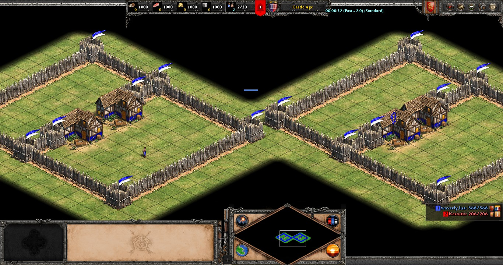
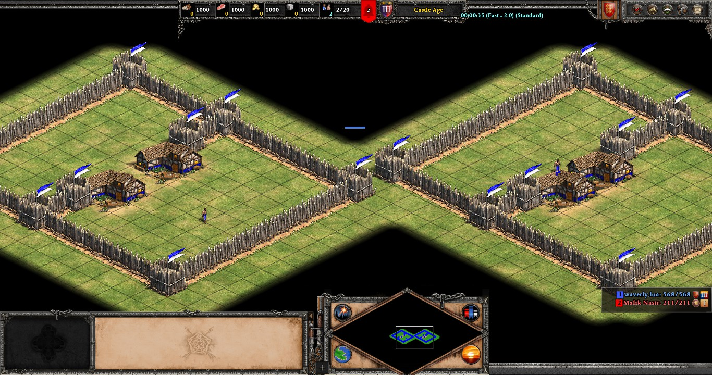
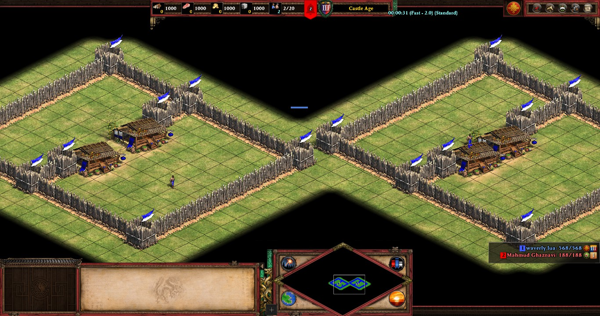
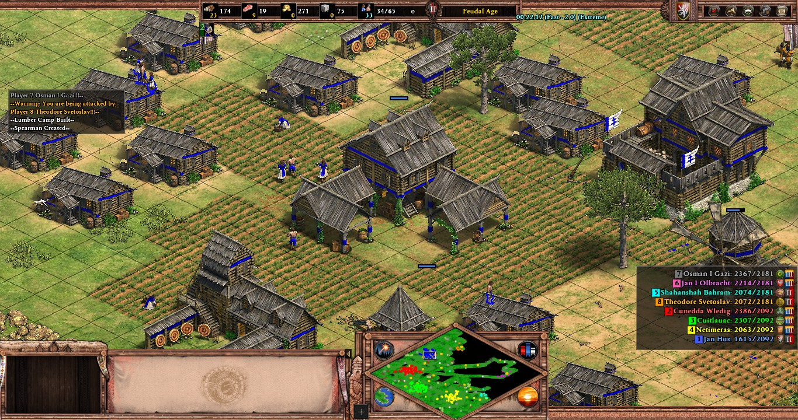
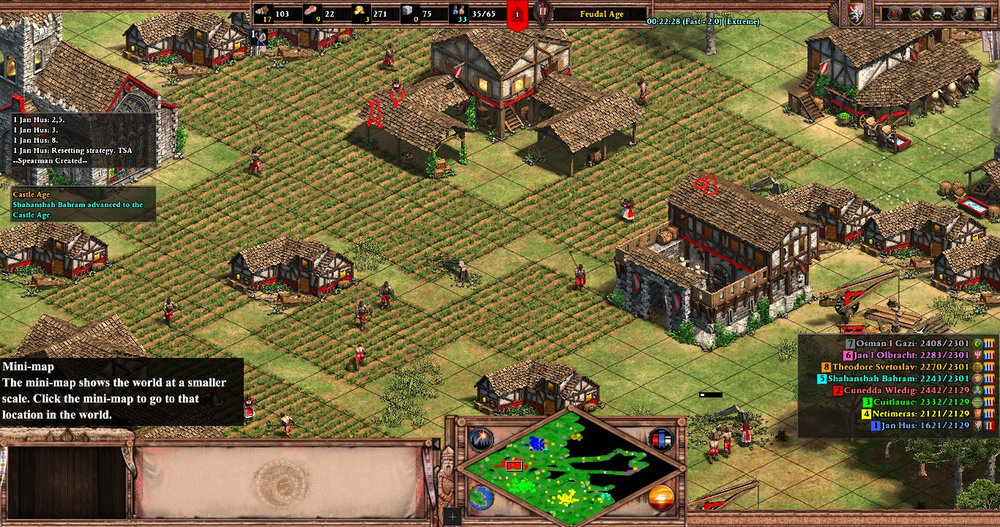
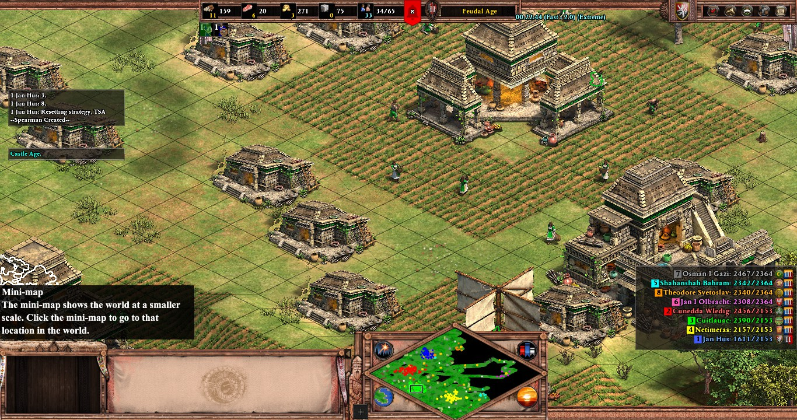
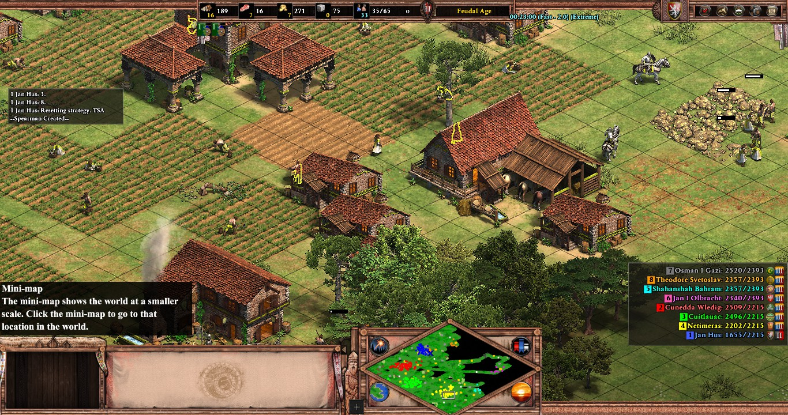

# Historical gallery: v0.4 / 110 px

Not current 0.6x Beta evidence.

### Historical v0.4 gallery

Author: **hiiwave**. These are unedited game captures from the final v0.4 graphics-only package. The installed 108 SLD files were hash-matched to its build manifest before testing.

## House gaps: original versus short houses

Each pair uses the same fixture geometry, camera and minimum zoom, with the grid enabled on flat grass. The left enclosure has an open one-tile gap; the right has touching houses. Across the four test runs, the left villager passed and the right villager remained blocked.

The useful visual difference is reduced roof occlusion: the blocked villager is easier to see with short houses. The deliberately open one-tile gap is visible in both versions. This demonstrates visibility, not a change to collision or a claim that every hidden gap is solved.

### Western / Britons, Castle Age

**Original graphics, 00:32**

**Final v0.4, 00:35**

### East Asian / Chinese, Castle Age

**Original graphics, 00:24**

**Final v0.4, 00:31**

**Comparison scope.** Geometry, camera and zoom match; exact time and animation frame do not. Original graphics use native randomized variants, while the mod repeats its selected variant. The comparison therefore includes both variant choice and shortening. Images are 1366 × 720 pixels.

## 4v4 Arabia: mixed-age bases

Eight built-in Extreme AI players with randomized civilizations. The same match save around 21 minutes was reloaded with final v0.4, then different bases were captured at 22–23 minutes. These are examples of ordinary base visibility, not paired before/after frames.

The top HUD remains attached to the viewing player. The captions identify the base being viewed; its age is also reflected in the scoreboard.

### Bohemians, Feudal Age · 22:12

### Celts, Castle Age · 22:28

### Aztecs, Castle Age · 22:44

### Lithuanians, Castle Age · 23:00

## Coverage

No visible rendering blocker was found in these sampled bases. Separate controlled tests covered damage, collapse and settled rubble for Western, Andean, Mediterranean, Central Asian and East Asian houses. Greek runtime testing was blocked by an unowned DLC; its exception has native-decoder checks only. Scaffolding and floating flames remain accepted limitations. UHD, snow, repair, all player colors and actual multiplayer were not exhaustively tested.

These captures complement the [production control-point diagrams](MATHEMATICS.md#9-mathematical-notation-versus-native-implementation) and [test status](TEST-STATUS.md).
