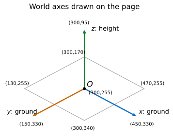
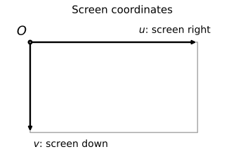
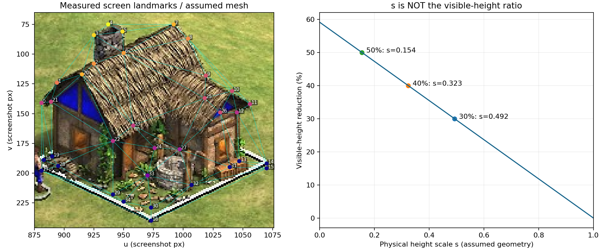
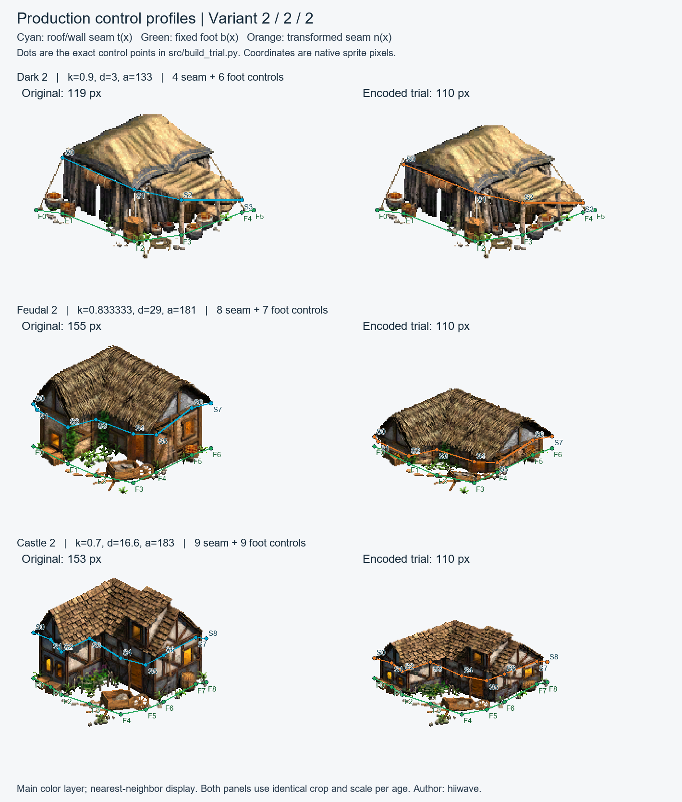
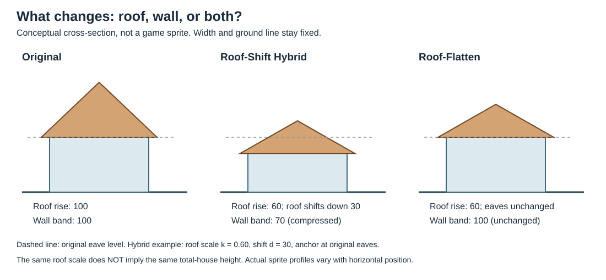
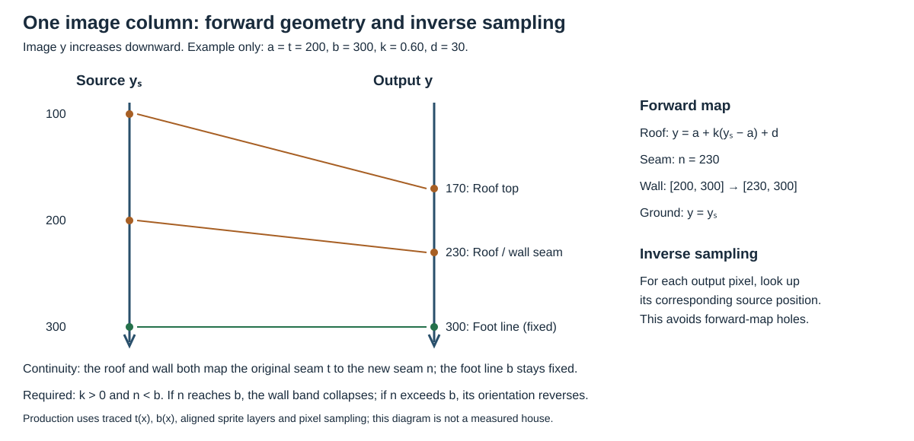

# Shortening isometric house sprites: geometry, constraints and implementation

> **Release context:** the current standard is 0.6x Beta / a 120 px upper bound. Numerical 110 px examples and annotated control profiles in this report are historical teaching/build examples, not current release parameters. The 35-point diagram is an explanatory historical model, not a claim that every production house uses that mesh.

## Purpose and reading guide

This report derives image-space transformations that lower a house silhouette while keeping its ground footprint fixed. The practical objective is to reveal space behind buildings without compressing doors and walls beyond recognition. It explains why a rigid roof shift can fail, how Roof-Shift Hybrid distributes the shortening, and how the continuous model becomes a raster operation.

No earlier report is required. Sections 1-2 define the measurements and projection assumptions; Sections 3-7 derive the transformation, inverse sampler and validity constraints; Sections 8-9 distinguish an alternative experiment from the historical v0.2 implementation. See [Technical specification](TECHNICAL-SPEC.md) for build parameters and [Test status](TEST-STATUS.md) for verification evidence.

**Two datasets must remain distinct.** The worked geometric example is a historical, manually annotated house screenshot with a 154 px landmark height. The historical v0.2 native-sprite trial instead targets a 110 px visible main-alpha bounding box. A screenshot measurement is not a native sprite measurement. Neither model recovers the game's true 3D geometry from one image.

### Notation and assumptions

| Symbol | Meaning |
|---|---|
| $(x,y,z)$ | Hypothetical world coordinates; $z$ increases upward |
| $(u,v)$ | Source screen coordinates; rightward/downward positive |
| $w$ | Destination vertical screen coordinate |
| $a,b,c$ | Positive projection coefficients, not warp parameters |
| $v_0,B,H$ | Original top, chosen fixed bottom, and landmark height |
| $t(u),\beta(u)$ | Traced roof/wall seam and fixed foot line |
| $q(u),L(u)$ | Transformed seam and original wall-band height |
| $A,k,d$ | Roof-warp anchor, vertical scale and downward translation |
| $\lambda(u)$ | Remaining wall-height fraction |

All image-coordinate lengths are pixels. The warp leaves horizontal position unchanged. Within each active column, the roof lies above the seam and the wall lies between seam and foot; these manually supplied regions must be meaningful for the depicted building. Ground remains fixed. Positive scale and noncollapsed wall bands are required. Native code uses different coordinate names, reconciled in Section 9.

## 1. Three meanings of height

Keep separate: world height; screen distance between chosen landmarks; and decoded main-alpha bounding-box height.

The historical screenshot study chose screen top $v_0=75$ and fixed front-ground reference $B=229$:

```math
H=B-v_0=154.
```

A 30% reduction meant:

```math
H_{\mathrm{target}}=(1-0.30)154=107.8,\qquad v_0'=229-107.8=121.2.
```

That excludes the screenshot selection border. It is **not** the native sprite-alpha definition. The historical v0.2 trial measures the main layer's visible bounding-box height, excluding the separate shadow, and targets 110 px. Source heights for Dark2/Feudal2/Castle2 are 119/155/153 px. Thus:

```math
1-\frac{110}{119}\approx7.56\%,\qquad
1-\frac{110}{155}\approx29.03\%,\qquad
1-\frac{110}{153}\approx28.10\%.
```

For a nonempty discrete alpha mask, bounding-box height counts occupied rows inclusively:

```math
H_{\alpha}=v_{\max}-v_{\min}+1.
```

A landmark distance instead subtracts coordinates without this extra row. Do not interchange these measurements. Equal final height does not imply equal roof scale or wall compression.

## 2. World projection and missing depth





These are the original coordinate diagrams used for the historical house study, preserved as vectors. The world axes explain the projected directions of $x,y,z$; screen $u,v$ point right/down. Numerical pairs printed in the illustrations are drawing coordinates, not reconstructed world coordinates. The diagrams define a modeling convention, not a measured game camera.

Let $(x,y,z)$ be hypothetical world coordinates, with $z$ height. Let screen $(u,v)$ increase rightward/downward. A useful parallel-projection model is:

```math
u=u_c+a(x-y),\qquad v=v_c+b(x+y)-cz,\qquad a,b,c\gt0.
```

The world axes project down-right, down-left and upward. This is not an estimated game camera. Calling it uniformly scaled orthographic projection in orthonormal world units additionally requires:

```math
2a^2=2b^2+c^2.
```

To see why, the projection's row vectors are $(a,-a,0)$ and $(b,b,-c)$. Their dot product is zero; their squared lengths are $2a^2$ and $2b^2+c^2$. A uniformly scaled orthographic projection requires both rows to have the same length. Without this extra condition the formula still defines a valid parallel image-space model.

Adding any multiple of the following vector leaves both screen coordinates unchanged:

```math
(1,1,2b/c).
```

Indeed, $a(1-1)=0$ and $b(1+1)-c(2b/c)=0$. One screen point therefore has a line of possible world preimages.

If height $z$ is independently known, set:

```math
U=\frac{u-u_c}{a},\qquad V=\frac{v-v_c+cz}{b}.
```

Then $x-y=U$ and $x+y=V$, giving:

```math
x=\frac{V+U}{2},\qquad y=\frac{V-U}{2}.
```

A known ground point has $z=0$; an arbitrary roof pixel does not.

### True world-height scaling

For a world deformation $z\mapsto sz$ with $x,y$ fixed, define that point's projected ground position $g=v_c+b(x+y)$. Since $v=g-cz$:

```math
v'=g-csz=g+s(v-g)=sv+(1-s)g.
```

Ground points remain fixed. But $g$ depends on surface depth; it is not generally one universal ground line per screen column. Uniformly squashing the sprite also squashes its projected ground footprint. More guessed landmarks do not recover missing depth.

For an assumed-depth mesh, assign each landmark $i$ a screen point $(u_i,v_i)$ and a hypothesized projected ground coordinate $g_i$. Set $v_i(s)=sv_i+(1-s)g_i$ and interpolate affinely within each fixed triangle. These $g_i$ are additional modeling inputs, not values determined by the screenshot alone.

Assume $B$ stays fixed and the same mesh covers the visible surface without foldovers or changing visibility. An affine vertical coordinate attains its minimum over each triangle at a vertex. The resulting landmark-envelope height is therefore:

```math
H(s)=B-\min_i\{sv_i+(1-s)g_i\}.
```



The historical screenshot model above uses **35 manual points (0-34)**, assumed ground coordinates $g_i$ and Delaunay triangulation. Its curve calibrates this particular mesh; more points constrain the model but do not resolve unknown depth. Historical v0.2 production profiles appear in Section 3.

Its visible reduction is $1-H(s)/H(1)$, not $1-s$. Its example $s\approx0.4923$ was a mesh-specific calibration, **not** the calibration for the rigid or hybrid methods below. The function can have corners when the highest landmark changes.

## 3. Join a roof to a fixed ground line



**Native 2/2/2 profiles:** left source, right encoded 110 px. Cyan is the source seam; orange its transformed position; green the fixed foot. Seam/foot point counts are Dark 4/6, Feudal 8/7, Castle 9/9. Each pair uses the same crop and scale; scale varies between ages. [Exact profiles and asset hashes](images/production-control-profiles.json).

These are the actual historical v0.2 production polylines, not the historical 35-point triangle mesh. The boundaries are manually specified; interpolation and inverse sampling are computed by the builder.

In image space, trace a roof/wall seam $t(u)$ and foot line $\beta(u)$, with:

```math
L(u)=\beta(u)-t(u)\gt0.
```

These are manually annotated, piecewise-linear curves, not recovered 3D surfaces.

Choose a new seam $q(u)\lt\beta(u)$. Seek an affine map in each wall column:

```math
W(u,v)=q(u)+\lambda(u)(v-t(u)).
```

Imposing $W(u,\beta(u))=\beta(u)$ determines:

```math
\lambda(u)=\frac{\beta(u)-q(u)}{\beta(u)-t(u)}.
```

Consequently:

```math
W(u,t(u))=q(u),\qquad W(u,\beta(u))=\beta(u).
```

This is affine in the vertical coordinate for each fixed column, not necessarily one global affine transformation.

**Order preservation.** If the roof map increases vertically, maps $t$ to $q$, and $q\lt\beta$, its join to the wall and unchanged ground is continuous and increasing in each column. Different columns retain different horizontal coordinates, so the continuous map is injective. For a fixed column, both the roof derivative and wall derivative $\lambda$ are positive, and the endpoint equalities join the intervals in order. Across columns, $u$ is unchanged; two different columns cannot map to the same point. Continuity across columns additionally requires continuous boundary curves and roof parameters on the active domain. This prevents continuous-map foldovers, not ugly proportions or lost raster details.

## 4. Rigid Roof-Shift

Translate the roof downward without changing its shape:

```math
R_\Delta(v)=v+\Delta,\qquad q(u)=t(u)+\Delta.
```

Substitution into the wall formula gives:

```math
\lambda(u)=1-\frac{\Delta}{L(u)}.
```

Valid positive-height walls require:

```math
0\le\Delta\lt\min_u L(u).
```

At equality a wall collapses; beyond it the column reverses. Even before collapse, a door may become unreadable.

For the historical height $H=154$, rigid20 used 30.8 px and rigid30 used 46.2 px. A sampled column had $t=175$, $\beta=219$, hence $L=44$:

```math
L'_{20}=44-30.8=13.2\gt0,\qquad
L'_{30}=44-46.2=-2.2\lt0.
```

The rigid30 image was a diagnostic failure, not valid finished art.

## 5. Roof-Shift Hybrid

### Illustrative transformation diagrams





These are explanatory vector diagrams, **not gameplay screenshots or measured asset previews**. Their sample $k=0.60$, $d=30$ px and seam/anchor at 200 are deliberately illustrative, not the historical production 110 px calibration.


Compress the roof vertically about anchor $A$ by $k$, then translate it by $d$:

```math
R_h(v)=A+k(v-A)+d=kv+C,\qquad C=(1-k)A+d.
```

Its seam becomes:

```math
q_h(u)=A+k(t(u)-A)+d.
```

Use $q_h$ in the wall map from Section 3. This joins the transformed roof to a fixed foot without a continuous-coordinate gap.

### Solve for total shortening

Assume the top remains on the transformed roof and the reference bottom stays fixed. Desired top displacement $D$ satisfies:

```math
D=R_h(v_0)-v_0=d+(1-k)(A-v_0).
```

For $A\gt v_0$:

```math
k=1-\frac{D-d}{A-v_0}.
```

The worked screenshot example uses $D=46.2$, $d=30.8$, $A=181$ and $v_0=75$:

```math
k=1-\frac{15.4}{106}\approx0.854717,\qquad C\approx57.096226.
```

Roof vertical height shrank about 14.53%, while landmark height shrank 30%. These percentages have different denominators.

For the earlier column:

```math
q_h\approx206.6717,\qquad
L_h'=219-q_h\approx12.3283,\qquad
\lambda_h\approx0.28019\gt0.
```

The minimum remaining wall height over the sampled screenshot columns was about 11.8843 px. These numbers concern that manually traced screenshot, not every native house.

### Roof slopes

A screen edge of slope $m$ transforms under $u'=u,\ v'=kv+C$ to:

```math
m'=km.
```

Indeed, $du'/du=1$ and $dv'/du=k\,dv/du$, so the finite screen slope is multiplied by $k$. Vertical edges remain vertical. The roof gets flatter for $0\lt k\lt1$. This is an intentional image-space approximation, not a claim of unchanged 3D roof geometry.

## 6. Inverse sampling

Moving source pixels forward can leave holes. Instead, for each destination $(u,w)$ find its source vertical coordinate.

Roof, for $w\lt q_h(u)$:

```math
v=\frac{w-C}{k}.
```

Wall, for $q_h(u)\le w\lt\beta(u)$:

```math
v=t(u)+\frac{w-q_h(u)}{\lambda_h(u)}.
```

Ground, for $w\ge\beta(u)$:

```math
v=w.
```

The roof branch follows by solving $w=kv+C$ for $v$; the wall branch follows by solving $w=q_h+\lambda_h(v-t)$. At $w=q_h$ both expressions return $t$, and at $w=\beta$ the wall expression returns $\beta$. Thus the continuous inverse agrees at both boundaries; choosing half-open intervals avoids double assignment.

The native implementation rounds to the nearest source pixel with NumPy's ties-to-even rounding and transforms aligned layers. It uses no generative fill. Subsequent native BC1/BC4 encoding is lossy, so copied pre-encoding colors need not remain identical.

These branches require positive roof/wall scales. A continuous injective map is not a bijection of raster pixels: thin features can disappear. The failed rigid30 diagnostic is not a valid nonoverlapping inverse-map partition.

## 7. Retain readable walls, not merely positive walls

Require at least a fraction $\eta$ of each original wall band:

```math
\lambda(u)\ge\eta,\qquad 0\lt\eta\lt1.
```

Equivalently:

```math
q(u)\le\beta(u)-\eta L(u).
```

For rigid translation:

```math
\Delta\le(1-\eta)L(u).
```

For Hybrid, substitute $q_h$. This supplies a parameter-search constraint, but a useful $\eta$ depends on actual doors, windows, roof proportions and gameplay readability. The project has not adopted one universal value for every architecture.

## 8. Roof-Flatten and the 110 px experiments

The later Roof-Flatten experiments keep eaves and walls fixed while reducing roof pitch. They differ from Roof-Shift Hybrid, whose seam moves.

A simple column map about the seam is:

```math
v'=t(u)+k(v-t(u))
```

for roof pixels. It fixes the seam, but varying $t(u)$ can bend a formerly straight ridge. Piecewise-affine meshes can constrain edges, yet moving a ridge below neighboring fixed eaves may invert triangles.

In the separate later Feudal2 Roof-Flatten experiment (not a measurement from the screenshot study above or the delivered build script), the tested equal-drop mesh needed a 45 px drop to change 155 into 110 px. One ridge vertex moved from 126 to 171, below its fixed eave at 153, folding that mesh.

**This is a failure of the tested constraints, not a theorem that 110 px Roof-Flatten is impossible.** Different ridge displacements, mesh topology or roof redesign may work. If walls are compressed too, call it combined/hybrid rather than pure Roof-Flatten.

## 9. Mathematical notation versus native implementation

| This report | Technical spec / code |
|---|---|
| horizontal $u$ | $x$, array column |
| vertical $v$ | $y$, array row |
| seam $t(u)$ | seam $t(x)$ |
| foot $\beta(u)$ | foot $b(x)$ |
| transformed seam $q_h(u)$ | $n(x)$ |
| anchor $A$ | anchor $a$ |
| translation $d$ | d |

The historical v0.2 trial's 110 px main-alpha target was calibrated on native sprites, not by reusing the screenshot example's 30% coefficients:

| Age / variant | Roof scale | Roof shift | Anchor |
|---|---:|---:|---:|
| Dark2 | 0.90 | 3.0 px | 133 |
| Feudal2 | 0.833333... | 29.0 px | 181 |
| Castle2 | 0.70 | 16.6 px | 183 |

Measure encoded/read-back height, masks and hashes after building. Integer sampling, visibility masks and block coding make symbolic height estimates insufficient.

## Provenance and reproducibility limits

The historical worked example and derivations were checked against the complete 10-page desktop report *Shortening a House Sprite: Projection, rigid roofs, and a hybrid warp*, emailed on 2026-11-16 UTC, then checked against the native implementation. Original PDF SHA256: a97ac6e3ef22435f79f8d082399defd6e3e18f7913e595c684c89ae1a3810f5a.

That source used one manually annotated screenshot, not automatic segmentation or a deployed mod. The definitions and derivations needed to follow this report are given above; the earlier PDF is not a prerequisite and is not uploaded. Historical screenshot numbers and historical native-sprite measurements remain distinct.
